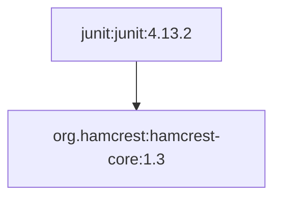
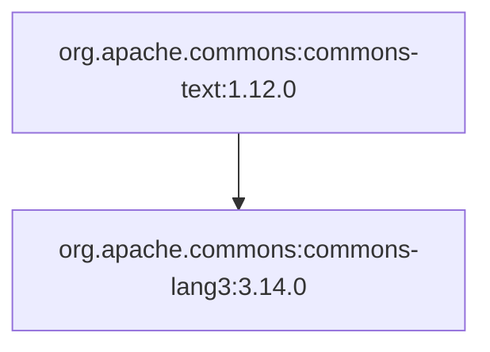
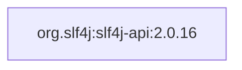

# Визуализация и сверка с Maven — этап 5

Реальные запуски выполнены 25.10.2026 с Maven Central.
Для каждого примера созданы Mermaid и PNG через Mermaid CLI 11.12.0.
PNG проверены по сигнатуре и просмотрены. Изображения, браузер, архивы
и кеши исключены из Git согласно правилам сборника.

## Три пакета

| Конфигурация | Пакет | Узлы / рёбра | Сверка с Maven |
| --- | --- | --- | --- |
| maven.yaml | junit:junit:4.13.2 | 2 / 1 | Полное совпадение |
| commons-text.yaml | org.apache.commons:commons-text:1.12.0 | 2 / 1 | Полное совпадение |
| slf4j.yaml | org.slf4j:slf4j-api:2.0.16 | 1 / 0 | Полное совпадение |

JUnit:



Commons Text:



SLF4J — корректный пример пакета без транзитивных runtime-зависимостей:



Те же исходники диаграмм сохранены в `diagrams/*.mmd`.
Команды воспроизведения из корня проекта:

```sh
./scripts/demo_visualization.sh
PYTHONPATH=src .venv/bin/python scripts/compare_maven.py \
    examples/maven.yaml examples/commons-text.yaml examples/slf4j.yaml
```

PNG появятся в `generated/junit.png`, `generated/commons-text.png`,
`generated/slf4j.png`; рядом — соответствующие `.mmd`.

## Сравнение со штатной визуализацией

Использован настоящий `mvn dependency:tree` с runtime scope, форматы
text и TGF. Его исходные результаты находятся в `comparison/*-tree.txt`
и `comparison/*-tree.tgf`; сводки — в `comparison/*-report.txt`.
Нейтральный Maven consumer исключён при сопоставлении. Сравниваются
полные координаты с версиями и направленные рёбра, а не только количество.

Расхождений состава графа в трёх проверенных случаях нет. Различия
представления: Maven показывает дерево с consumer-корнем, типом JAR и
scope; Mermaid показывает направленный граф выбранного пакета с версиями.
В учебных примерах общая зависимость — один узел графа, а в ASCII-дереве
повторное появление помечается `[shared]`. Возврат к предку помечается
`[cycle]` и не разворачивается бесконечно. В Mermaid циклическое ребро
сохраняется. Отсутствие рёбер у SLF4J согласуется с Maven.

Ограничения интерпретации Maven перечислены в README; совпадение этих
трёх примеров не означает полную совместимость с любым Maven-проектом.
